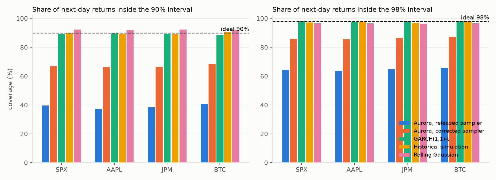

# Is Aurora calibrated on daily returns?

A zero-shot calibration test of **Aurora** (Wu et al., *Aurora: Towards Universal Generative Multimodal Time Series Forecasting*, ICLR 2026, [arXiv:2509.22295](https://arxiv.org/abs/2509.22295)) on daily returns of the S&P 500, Apple, JPMorgan and Bitcoin, 2020 to 2026, against standard econometric baselines.

Aurora produces probabilistic forecasts by flow matching. A forecast range is only useful if it is honest: a 90% interval should contain about 90% of outcomes, and a 1% value-at-risk should be breached about 1% of the time. This repository tests that, in the tails, using the released checkpoint exactly as published.

## Headline results

Average over the four assets, next-day forecasts, January 2020 to October 2026 (1,699 to 2,472 forecasts per asset):

| Method | 90% interval covers (ideal 90%) | 98% interval covers (ideal 98%) | 1% VaR breached (ideal 1%) | 5% VaR breached (ideal 5%) | CRPS (lower is better) |
|---|---|---|---|---|---|
| Aurora, released sampler | **39.0%** | 64.6% | **24.6%** | 31.5% | 1.274 |
| Aurora, corrected sampler | 67.0% | 86.2% | 9.6% | 15.9% | 1.186 |
| GARCH(1,1) with Student-t errors | 89.2% | 98.0% | 1.4% | 6.3% | **1.032** |
| Historical simulation | 89.7% | 97.4% | 1.3% | 5.1% | 1.054 |
| Rolling Gaussian | 92.1% | 96.5% | 2.0% | 4.4% | 1.070 |

- **After the paper's release** (October 2025 to October 2026, data that cannot be in pretraining): 90% coverage of 37.8% (released), 64.7% (corrected) and 90.1% (GARCH-t). The result is not an artefact of training-data overlap.
- **COVID crash** (15 February to 30 April 2020): 16% (released), 30% (corrected) and 80% (GARCH-t).
- **Backtests:** Kupiec's test rejects Aurora's breach rate at 1% and 5% for every asset and both samplers (all p < 0.0001).
- **Cost:** about 0.22 s per Aurora forecast (1,000 samples, RTX 3060 GPU) against about 30 ms for a GARCH-t refit on a CPU.



## The sampler

The released code trains the network to predict the end point of the flow, and its sampler moves each step by `(prediction - starting noise) * dt`. Summed over the 50 steps, the final sample is exactly the **average of the 50 end-point predictions** along the path. Early predictions, made from almost pure noise, sit near the conditional mean, so averaging them shrinks the spread.

The **corrected sampler** (`aurora_model.corrected_sample`) changes only the update, to the Euler step on the velocity implied by an end-point prediction, `(prediction - x) / (1 - t)`. This is the update the paper describes. Both samplers run on identical random noise.

| Check | Released | Corrected | Target |
|---|---|---|---|
| Toy problem with a known answer, sample standard deviation (`tests/test_sampler.py`) | 0.48 | 0.98 | 1.00 |
| Seasonal series, 90% interval coverage | 47.9% | 77.6% | 90% |
| Seasonal series, accuracy (MASE, lower is better) | 0.761 | 0.785 | |
| Daily returns, 90% interval coverage | 39.0% | 67.0% | 90% |

The toy check runs the authors' own `FlowLoss.sample` with an exact predictor in place of the network, so it tests the released code itself, not a reimplementation.

Most of the under-dispersion comes from the sampler, it is not specific to finance, and fixing it costs almost no accuracy. The remaining gap is a modelling question: a Gaussian source distribution, a training loss that drops very large errors, little finance in pretraining, and per-window normalization that ignores volatility clustering. The same sampler update appears in the released code of Sundial.

## Design

| Choice | Value |
|---|---|
| Data | daily adjusted closes from Yahoo Finance, 2005 to October 2026; log returns in percent |
| Forecast origins | every trading day from 2 January 2020 to 6 October 2026, rolling one day at a time |
| Aurora input | the last 528 returns (its default context, 11 patches of 48); univariate, no text, no fine-tuning |
| Aurora output | 1,000 sampled 48-day paths per forecast; day 1 is scored |
| Batch size | 1, because the model picks its image period from the batch-averaged spectrum |
| Baselines | rolling Gaussian and historical simulation on the same 528 returns; GARCH(1,1)-t refit daily on the last 1,000 returns |
| Metrics | 90% and 98% coverage; 1% and 5% VaR breach rates with Kupiec and Christoffersen tests; pinball loss at 1%, 5%, 95%, 99%; CRPS (twice the mean pinball loss over the 1% to 99% grid); interval width |

Sanity check first: on 50 noisy seasonal series, the kind of data Aurora is built for, its median forecast tracks the truth (correlation 0.94) and beats a seasonal-naive forecast (MASE 0.76 against 0.83), so the pipeline calls the model correctly.

## Figures

| File | What it shows |
|---|---|
| `figures/fig1_coverage.png` | coverage of the 90% and 98% intervals, per asset and method |
| `figures/fig2_pit_spx.png` | PIT histograms for the S&P 500: flat means calibrated, a U means intervals too narrow |
| `figures/fig3_covid_var.png` | S&P 500, January to June 2020, with each method's 1% VaR line: 43 breaches of Aurora's line (released), 26 (corrected), 4 for GARCH-t |
| `figures/fig4_width_vs_coverage.png` | interval width against coverage |
| `figures/fig5_endogenous_images.png` | the image Aurora builds from a series; on returns the FFT finds no real period, so the image becomes a barcode |

## Limitations

- **Zero-shot only.** This is the released checkpoint with no fine-tuning, and the paper does not claim to forecast stock returns. What it shows is that universal zero-shot probabilistic forecasting does not carry over to financial returns without work.
- **The corrected sampler is a change to the released code.** It is the standard Euler step for an end-point-predicting flow, but the model was trained alongside the released sampler, so both are reported.
- **Quantile noise.** A 1% quantile from 1,000 samples rests on about 10 samples. That noise is small next to breach rates of 10% to 25%.
- **Scope.** One horizon, four assets, one seed per forecast, no text input. Christoffersen's test finds breach clustering in several series, so conditional coverage is worse than the raw rates suggest.

## Reproduce

Python 3.11 with a CUDA GPU for step 2 (Aurora's released code needs torch 2.4 and transformers 4.40).

```
python -m venv .venv && .venv\Scripts\activate      # or: source .venv/bin/activate
pip install -r requirements.txt                       # torch with CUDA 12.1 from download.pytorch.org
python setup_aurora.py                                # the authors' model code (commit a247760) -> vendor/aurora
python -m pytest tests                                # sampler and metric tests, about 10 s, no GPU needed

python 01_get_data.py                                 # prices from Yahoo Finance -> data/
python diag_one_forecast.py                           # optional: one forecast, both samplers
python diag_sanity_seasonal.py                        # optional: the seasonal sanity check
python 02_aurora_forecasts.py both                    # about 55 min on an RTX 3060; weights download once
python 03_baselines.py                                # about 4 min on a CPU
python 04_evaluate.py                                 # metrics, backtests, figures
python diag_endogenous_images.py                      # optional: figure 5
```

`python 02_aurora_forecasts.py both --limit 3` is a two-minute smoke test that writes `*_smoke.npz` files and never touches real results. Every forecast is seeded by its date and asset, so reruns reproduce the saved results exactly. Price data and per-forecast outputs are not included; the scripts regenerate them. Full per-asset tables are in `results/metrics_tables.md`, raw numbers in `results/metrics.csv`.

## Repository layout

| File | What it does |
|---|---|
| `common.py` | settings (assets, windows, quantile grid, periods), data loading, the forecast file format |
| `aurora_model.py` | loads the released checkpoint; `use_sampler(model, 'released' or 'corrected')` |
| `metrics.py` | pinball loss, CRPS, Kupiec and Christoffersen tests |
| `01_get_data.py` | downloads prices and builds log returns |
| `02_aurora_forecasts.py` | rolling Aurora forecasts with either or both samplers |
| `03_baselines.py` | rolling Gaussian, historical simulation, GARCH(1,1)-t |
| `04_evaluate.py` | scores every method and draws figures 1 to 4 |
| `diag_*.py` | the one-forecast check, the seasonal sanity check, the endogenous-image figure |
| `tests/` | the sampler identity and toy check on the released code; metric tests on known answers |
| `setup_aurora.py` | fetches the released Aurora code from the authors' repository |

## Credits

Aurora's model code and weights are by the paper's authors: [github.com/decisionintelligence/Aurora](https://github.com/decisionintelligence/Aurora) and [huggingface.co/DecisionIntelligence/Aurora](https://huggingface.co/DecisionIntelligence/Aurora). They are not redistributed here: `setup_aurora.py` and the first forecast run fetch them from the source. The evaluation code in this repository is MIT-licensed (see `LICENSE`).

Akash Deep, October 2026.
